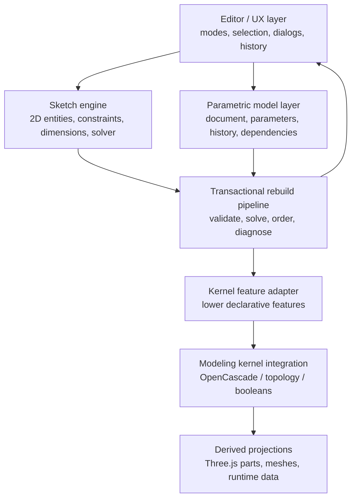

# Dodel editor: parametric rewrite

## Outcome

The model editor is now split into an authoring system and an execution system.
The user-facing path is:

1. open a part document with units, origin, datum planes and axes;
2. choose a named plane or persistent face;
3. create and solve a dedicated sketch;
4. finish the sketch intentionally;
5. configure a declarative feature;
6. rebuild and edit that feature from ordered design history.

The existing Three.js part records and OpenCascade operations remain useful,
but they are adapters below this workflow. They are no longer the intended
source of design intent.

## Critique of the former architecture

The repository already had an unusually capable sketch solver, topology
mapping, OpenCascade integration and many operations. The problem was ownership
and workflow rather than geometry capability.

| Former behavior | Conceptual failure | Rewrite |
| --- | --- | --- |
| `parts` was documented and rendered as “the feature history” | A render-friendly box/extrusion record cannot express sketch support, selection intent, end conditions or robust dependencies | `history` contains typed sketch and feature nodes; `parts` is a compatibility render projection |
| save/regenerate called `rebuildFeatureTreeFromDocument()` | Design intent was reverse-engineered from final preview geometry at the last moment | Feature definitions are written when the user commits a feature; save compiles existing history |
| box, cylinder, sphere, cut and sketch tools appeared together as peer creation commands | The default workflow encouraged direct solid mutation and mixed sketch/solid state | The Features tab starts with Create Sketch and exposes declarative boss, cut, revolve, sweep, loft and finishing features |
| entering a draw tool could silently create or switch sketch context | Reference selection was implicit UI state | Create Sketch opens an explicit stable-reference chooser |
| quick fillet/shell/pattern commands mutated a selected preview part | Operations existed geometrically but did not necessarily exist as editable history | Quick controls create canonical feature records first, then update the preview adapter |
| canonical references and legacy `referenceGeometry` were maintained separately | New datum geometry could be visible without being a valid authoring reference | creating datum geometry now also writes the canonical reference table |
| exact regeneration used the same array the UI happened to mutate | UI and kernel were coupled through storage shape | `kernel_feature_adapter.js` lowers authoring features into the kernel vocabulary |
| rebuild checked a non-existent `result.dof` field | Under-defined sketches could be presented as fully defined outside the sketch UI | rebuild reads the solver’s real `degreesOfFreedom` result and publishes under/partially/fully-defined state |

Imported or unrecognized exact bodies are a deliberate exception. They remain
explicit `direct-only` or `hybrid` migration inputs. They can be consumed by
downstream parametric features, but the application does not pretend to have
recovered design intent that cannot be proven from topology.

## Target architecture



### Sketch engine

Existing solver modules remain responsible for points, lines, circles, arcs,
construction geometry, dimensions, equations and geometric constraints. A
sketch now always carries `referenceId` or a persistent topology `support`.
Its published state is one of `under-defined`, `partially-defined`,
`fully-defined` or `conflicting`.

### Parametric model layer

`js/core/parametric_document.js` owns authoring semantics:

- canonical part context and units;
- typed sketch and feature history nodes;
- create/edit/suppress/remove operations;
- dependency-safe reorder rules;
- explicit dependency diagnostics;
- migration of string-only legacy history.

`js/core/feature_catalog.js` is the shared feature vocabulary. The UI and
kernel adapter no longer keep separate, drifting definitions of feature names,
required selections, defaults and parameter validity.

### Modeling-kernel integration

`js/core/kernel_feature_adapter.js` is the only new lowering boundary. For
example, an authoring-level `extrudeCut` remains one editable history feature,
while compilation emits an extrusion tool followed by a subtract operation.
The adapter covers:

- Extrude / Boss
- Extrude Cut
- Revolve
- Sweep
- Loft
- Fillet
- Chamfer
- Shell
- linear/circular Pattern
- Mirror
- union/subtract/intersect Boolean

`js/cad_feature_tree.js` remains the exact executor. Mirror is now an exact BREP
operation as well as a preview operation. Sketch nodes are non-solid execution
steps, so sketches remain visible in history without becoming geometry.

### Rebuild pipeline

`js/core/parametric_rebuild.js` rebuilds a cloned document snapshot:

1. validate feature definitions and required selections;
2. validate history order and upstream dependencies;
3. solve sketches and materialize dimensions/parameters;
4. compile authoring features into kernel operations;
5. run deterministic semantic rebuild;
6. publish per-history-node states and actionable diagnostics;
7. retain the last good result on failure.

The authoring document is never half-mutated by a failed rebuild. Topology
healing is still applied only through the existing explicit save audit.

## Domain model

### Part document

```js
{
  id, revision, schemaVersion, documentVersion,
  context: {
    kind: "part",
    units: { length: "cm", angle: "deg", mass: "kg", precision: 3 },
    activeCoordinateSystemId: "origin"
  },
  references: [], parameters: {}, sketches: [], features: [], history: [],
  topologyBindings: [], lastRebuild
}
```

### Stable reference

A datum reference has a stable `id`, `type`, name and coordinate definition. A
generated face/edge uses a topology reference with `ownerFeatureId`,
`persistentId`, semantic role and geometric descriptor. Sketch supports and
finishing targets store these records, never a transient explorer index.

### Sketch

```js
{
  id, name, referenceId,
  support, frame, frameSpace, supportOffset,
  points: [], entities: [], constraints: [], dimensions: [],
  status, diagnostics
}
```

Dimensions remain solver constraints with driving/reference roles and optional
equations. They are not display annotations.

### Feature

```js
{
  id, type, name,
  params: { /* depth, radius, endCondition, count, … */ },
  references: {
    sketches: [], features: [], topology: [], references: []
  },
  inputs: [], suppressed,
  state, diagnostics
}
```

Every feature has explicit references, a validated parameter object, defaults,
selection requirements, suppression state and rebuild state. Preview parts do
not own these values.

### History node

```js
{
  id: "history:feature:feature-id",
  kind: "sketch" | "feature",
  targetId,
  name,
  suppressed,
  status: "pending" | "rebuilt" | "warning" | "failed" | "suppressed"
}
```

A reorder is accepted only if all sketch, feature and topology dependencies
remain upstream. Deleting a used node is rejected with the names of dependants.
Suppressing an upstream dependency produces a rebuild diagnostic rather than a
corrupt body.

## Interaction model

The editor has five persistent workflow stages: Part, Reference, Sketch,
Feature and History.

- **Part:** shows units and active coordinate system.
- **Reference:** Create Sketch opens a modal list of datum planes plus the
  selected persistent face when valid.
- **Sketch:** only sketch tools are primary. The workflow bar and sketch panel
  report definition state and degrees of freedom. Finish Sketch refuses a
  conflicting solve.
- **Feature:** feature dialogs show required selections, end condition and
  numeric parameters before commit. Sketch drawing does not create a solid.
- **History:** sketches and features share one ordered tree. Click selects,
  Ctrl/Cmd-click builds multi-selection for loft/boolean workflows,
  double-click edits, and row actions suppress, delete or dependency-safely
  reorder.

Direct primitive creation is absent from the default Features surface. Legacy
shortcuts are intercepted in canonical documents and route the user toward a
sketch or feature instead of mutating geometry.

## Migration strategy

Migration is incremental and lossless:

1. `ensureParametricDocument()` adds document context, units, canonical
   references and typed history without dropping unknown legacy fields.
2. Existing sketch-backed features are classified as `parametric-v1` and their
   sketches are inserted before first consumption.
3. Existing procedural/primitive documents without proven sketch intent are
   marked `legacy-adapter`; their former part-tree workflow remains readable.
4. Recognized STEP geometry retains reconstructed parametric history.
5. Unrecognized BREP/mesh data remains explicit `direct-only`; exact payload
   and topology are preserved, and downstream authored features promote the
   document to hybrid.
6. The Three.js `parts` array remains temporarily as a derived preview and
   catalogue compatibility projection. New canonical saves never regenerate
   feature history from it.

This avoids fabricating constraints or references for old geometry and lets
saved models, cabinets, imports and planner instances migrate independently.

## Phased implementation plan

### Phase 1 — canonical authoring domain (implemented)

- units/reference-aware part context;
- shared feature catalogue;
- typed sketch/feature history;
- edit, suppression, removal and dependency-safe reorder APIs;
- focused domain tests.

### Phase 2 — deterministic rebuild and kernel boundary (implemented)

- transactional snapshot rebuild;
- solver status and diagnostics publishing;
- high-level feature lowering;
- exact mirror support;
- last-good result contract.

### Phase 3 — canonical editor workflow (implemented)

- persistent five-stage workflow bar;
- explicit reference picker;
- intentional sketch entry/finish;
- feature parameter panels;
- canonical history tree and feature editing;
- canonical save and exact-regeneration paths.

### Phase 4 — remove remaining preview ownership (next)

- generate every Three.js preview part only from rebuild results;
- remove parametric inspector branches that edit part coordinates directly;
- make cut/pattern/mirror previews consume compiled results rather than keep
  small compatibility deltas on preview parts;
- move rollback visualization entirely from legacy part indexes to history IDs.

### Phase 5 — production feature depth

- robust up-to-face/up-to-next termination in the exact kernel adapter;
- guide curves and continuity controls for sweep/loft;
- variable fillet/chamfer and multi-body result management;
- complete topology-name propagation through every Boolean;
- configurations and feature-level parameter tables.

### Phase 6 — production UX and interoperability

- section/measure/face-identification inspection workspace;
- dependency graph inspector and failed-feature repair actions;
- associative drawing dimensions sourced from feature/sketch parameters;
- migration UI for converting eligible legacy-adapter documents;
- performance profiling and incremental exact rebuild caches.

## Verification

- `tests/parametric_authoring.test.mjs` pins units, explicit sketch references,
  typed history, dependency-safe reorder, editing, suppression, cut lowering,
  deterministic rebuild and sketch definition-state diagnostics.
- Existing solver, topology, kernel, import, cabinet and project tests continue
  to protect the retained low-level capabilities.
- Browser verification exercises a clean new document through Top Plane →
  sketch rectangle → Finish Sketch → 35 cm Extrude, then double-click history
  editing to 50 cm, suppression/unsuppression and invalid reorder rejection.

