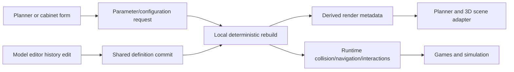

# ModelForge parametric architecture

## Architecture map before this migration

| Surface | Former source of truth | Geometry/update path | Persistence |
| --- | --- | --- | --- |
| Spatial planner | `S.nodes`, `S.walls`, `S.openings`, `S.items` | Planner mutated item `w/d/h`; `view3d.js` called a `FURN[type].build` procedure | Scene JSON and plan history snapshots |
| Model editor | Independent `E.def` document with `parts`, `sketches`, `features` | Editor-local sketch solver/part builders and optional OpenCascade regeneration | `home3d_models` localStorage plus embedded `customModels` |
| Cabinet designer | `item.cab` semantic spec beside raw item dimensions | `layoutCab()` generated parts, motion units, BOM and quote; the UI mutated the spec directly | Item JSON plus cabinet-local edit history |
| Games/simulation | Rendered Three.js scene | Night Shift and RC traversed rendered meshes and measured world AABBs | Runtime module state |
| Undo/project storage | Three separate edit histories; IndexedDB project snapshots | Whole-scene swaps | `ui.js`, `history.js`, `project_store.js`, `persist.js` |

The important pre-existing assets retained by the migration are the sketch solver, equations, profile tools, OpenCascade feature regeneration, cabinet construction rules, hardware/stock libraries, BOM/quote logic, and staged door/drawer motion.

## Replaced abstractions

- Raw planner dimensions no longer represent a geometry scale operation. They are compatibility projections of named instance parameter overrides.
- Reusable definitions no longer live only in the model editor's localStorage library. The project document owns the definitions used by its spatial instances.
- Cabinet specs are no longer an incompatible modeling system. `parametric_cabinet.js` adapts the semantic cabinet layout to canonical parameters, reference geometry, sketches, features, parts, rules, interactions, BOM and price metadata.
- Render meshes are no longer the only game representation. Local rebuilds publish cached collision/navigation/interaction data to the runtime projection.
- Door/drawer opening is no longer treated as a design rebuild. It is instance runtime state, with `cab.open` retained only as a compatibility projection for the existing motion builder.
- The model editor no longer opens a planner object as an anonymous mesh snapshot. It opens the linked canonical definition; built-ins are explicitly hybrid and cabinets arrive as a constrained front sketch plus semantic ordered features.

## Target module structure

```text
js/
  core/
    schema.js              definitions, instances, parameters, references, import classification
    authoring_mode.js      fully-parametric, hybrid and direct-only classification
    import_normalization.js imported mesh normalization and analytic primitive reconstruction
    binary_payload.js      checksummed serializable exact-geometry attachments
    attachment_store.js    SHA-256 attachment references, IndexedDB storage and bundle manifests
    frame.js               deterministic orthonormal sketch/world coordinate frames
    dependency_graph.js    stable feature dependency order and cycle/missing-reference diagnostics
    rebuild.js             parameter/sketch/feature rebuild and deterministic derived result
    topology.js            persistent face/edge names, geometric rebinding and healing audit
    product_rules.js       versioned authored catalogue rule packs
    cabinet_advanced.js    semantic-cabinet ↔ advanced-CAD delta and feature projection
    smart_dimension.js     planner dimension validation and configuration alternatives
    project.js             project definition registry, instance links, propagation and persistence bridge
    runtime.js             derived collision/navigation/snap/interaction representations
  parametric_cabinet.js    cabinet semantic-model adapter
  modeler.js               canonical advanced authoring UI
  ui.js                    planner quick-parameter workflow and proposal UI
  ui_cabinet.js            composition, technical, and advanced cabinet workflows
  cabinet.js               retained cabinet rules/layout/motion/BOM/price engine
```

`S.items` remains the spatial instance collection so the large existing planner can migrate incrementally. Each item now has `definitionId`, `parameterOverrides`, `configuration`, optional material overrides, placement fields, and separate runtime state. `S.parametric.definitions` is the reusable definition registry; `derived` and `runtime` are disposable caches.

## Rebuild/update flow



Only the edited definition/instances rebuild. Rendering and games consume cached outputs. Placement-only moves refresh runtime transforms without rebuilding feature history.

## Migration phases and files

### Phase 1 — shared domain and spatial project ownership

Changed: `js/core/schema.js`, `js/core/project.js`, `js/state.js`, `js/ui.js`, `js/history.js`, `js/main.js`, `js/furniture_api.js`.

Why: introduce reusable definitions, instance links/overrides, canonical references, project persistence, undo/redo coverage, and a compatibility bridge for existing procedural furniture.

Status: closed in Phase 15. Structure, rooms, openings and object instances now belong to one versioned spatial document; legacy planner properties are live accessors over that document, not copied state.

### Phase 2 — deterministic authoring/rebuild core

Changed: `js/core/dependency_graph.js`, `js/core/rebuild.js`, `js/modeler.js`.

Why: validate references and dependency order, solve sketches locally, resolve parameters, stop downstream rebuilds on failure, publish diagnostics, and make editor saves propagate through one shared definition.

Status: exact topology and reconstruction now cover primitives, linear extrusions, pocketed orthogonal bodies, revolved profiles, linear/circular patterns and disconnected box assemblies. Ambiguous history-free geometry intentionally uses the canonical direct-only fallback required by the import contract.

### Phase 3 — planner quick editing and smart dimensions

Changed: `js/core/smart_dimension.js`, `js/ui.js`, `css/styles.css`.

Why: replace direct size mutation with parameter requests, product-family ranges, discrete size families, supported-span checks, configuration alternatives and explicit confirmation.

Status: closed in Phase 15. Hydroponics, HVAC, lighting, plumbing, electronics, circulation, characters and long-tail decor now have authored versioned policies and invariants.

### Phase 4 — cabinet three-level workflow

Changed: `js/parametric_cabinet.js`, `js/cabinet.js`, `js/ui_cabinet.js`, `js/modeler.js`, `css/styles.css`.

Why: retain the proven cabinet generator and expose it as canonical features; add explicit Composition, Technical and Model Editor levels; add independent shelf thickness; preserve stock/hardware/BOM/price logic and staged door/drawer motion after advanced saves.

Status: advanced cabinet parts retain geometry and history and now expose manufacturing role/material assignment in the model editor. Classified parts generate cost rows and sheet nesting; only genuinely unclassified or deleted semantic parts require review.

### Phase 5 — runtime projection

Changed: `js/core/runtime.js`, `js/view3d.js`, `js/state.js`, `js/zombies_world.js`, `js/rc_world.js`, `js/cabinet.js`, `js/ui_cabinet.js`.

Why: generate lightweight collision/navigation/snap/interaction metadata on definition changes, refresh only transforms on placement changes, and keep simulation state out of authoring rebuilds.

Status: this is the completed hybrid runtime design. Destruction bodies are disposable, lazy runtime projections and never become a second authoring source of truth.

### Phase 6 — persistent topology and authored catalogue policy

Changed: `js/core/topology.js`, `js/core/product_rules.js`, `js/core/dependency_graph.js`, `js/core/rebuild.js`, `js/core/smart_dimension.js`, `js/core/project.js`, `js/core/schema.js`, `js/cad_feature_tree.js`, `js/cad_mates.js`, `js/parametric_cabinet.js`, `js/modeler.js`, `css/styles.css`.

Why: replace edge/face explorer indices and cabinet-global part indexes with stable semantic names and geometric descriptors; make topology references participate in dependency ordering; explicitly rebind or fail downstream features; heal unambiguous references only on save with an audit trail; drive sketch dimensions from canonical parameters; replace random proposal IDs and generic regex inference with deterministic, versioned catalogue rule packs.

Status: authored catalogue coverage is complete. A radical topology change with no unique match remains an explicit diagnostic by design; silently guessing a reference would violate deterministic rebuild requirements.

### Phase 7 — exact kernel topology and direct model-editor selection

Changed: `js/cad_kernel.js`, `js/cad_feature_tree.js`, `js/core/topology.js`, `js/modeler.js`, `css/styles.css`, `tests/cad_kernel_topology.test.mjs`.

Why: extract exact OpenCascade face/edge descriptors and live subshape handles; bind analytic semantic IDs onto kernel topology; assign deterministic names to generated boolean/fillet/import topology; publish mesh triangle-to-face ranges; let the model editor select faces and multi-select edges directly; store those selections as persistent references; and build selected-edge fillets as ordered exact history features instead of mutating a 2D profile. Part copies now receive independent feature identities, and exact topology descriptors move with copied geometry.

Status: exact finishing, face sketches and reconstruction are complete. Browser delivery now uses a 13 MB gzip-streamed kernel asset with a compatible fallback instead of transferring the raw 48 MB WASM during normal authoring startup.

### Phase 8 — exact finishing operations and face-supported sketches

Changed: `js/cad_kernel.js`, `js/cad_feature_tree.js`, `js/core/topology.js`, `js/core/rebuild.js`, `js/sketch_solver.js`, `js/modeler.js`, `css/styles.css`, `tests/cad_kernel_topology.test.mjs`, `tests/topology_and_rules.test.mjs`.

Why: replace the last profile-mutating chamfer and shell shortcuts with selected-subshape OpenCascade operations; store fillet, chamfer and shell as ordered per-part history; remove consumed topology from downstream naming; attach sketches to persistent planar face references at the actual face elevation; drive supported extrusions from the rebuilt face origin and normal; and report missing or ambiguous sketch supports as rebuild failures. Exact meshes now render for boxes and straight cylinders as well as generic extrusions, so applying a finishing feature no longer converts the authored primitive or loses its semantic edge names.

Status: compound recognition, catalogue policies and compressed production kernel delivery are completed in Phase 15.

### Phase 9 — arbitrary planar sketch frames and normal-driven authoring

Changed: `js/core/frame.js`, `js/core/schema.js`, `js/core/topology.js`, `js/core/rebuild.js`, `js/cad_kernel.js`, `js/cad_feature_tree.js`, `js/editor_view.js`, `js/modeler.js`, `tests/arbitrary_sketch_frames.test.mjs`.

Why: make every planar topology face a valid sketch support, not only a face parallel to Top/Front/Right. A canonical orthonormal U/V/W frame now maps sketch coordinates into world space, analytic and exact extrusions travel along the face normal, and supported frames are recomputed from persistent topology after upstream changes. The model editor locks its camera and grid square to the selected face, projects picking/snapping into local U/V, creates primitives and exact through-cuts in that frame, preserves face-relative support offsets, and reports malformed local frames as rebuild errors. Saving/normalizing a reusable object now translates its sketches and topology references with its parts before rebuilding canonical history, preventing normalized render parts from diverging from their feature definitions.

Status: cylindrical, conical and spherical faces now use a separate arc-length UV sketch domain with persistent topology support, rebuild diagnostics and unwrapped model-editor authoring. Unsupported freeform B-spline surfaces remain direct modeling inputs rather than being falsely flattened.

### Phase 10 — lossless cabinet advanced-edit propagation

Changed: `js/core/cabinet_advanced.js`, `js/parametric_cabinet.js`, `js/modeler.js`, `tests/parametric_core.test.mjs`.

Why: preserve the model editor as the cabinet geometry authority after returning to Composition or Technical editing. Saving an advanced cabinet now records a deterministic delta against the semantic generator: modified/deleted generated parts, added authored parts, and modified/added sketches. Every later cabinet rebuild regenerates valid library-driven construction, reapplies that delta by stable semantic IDs, reconstructs the advanced parts as canonical feature history (including framed extrusions, cuts and exact finishing operations), and retains the existing interaction, BOM and quote projections. Deltas that no longer map cleanly to manufacturing semantics explicitly mark the definition as hybrid and require manufacturing review instead of silently disappearing.

Status: closed in Phase 15. The model editor provides role/material classification and classified authored parts participate in advanced BOM cost and sheet nesting.

### Phase 11 — canonical imported and AI-generated model normalization

Changed: `js/core/authoring_mode.js`, `js/core/import_normalization.js`, `js/core/schema.js`, `js/core/topology.js`, `js/core/rebuild.js`, `js/core/project.js`, `js/core/runtime.js`, `js/cad_feature_tree.js`, `js/modeler.js`, `tests/import_normalization.test.mjs`, `tests/cad_kernel_topology.test.mjs`.

Why: route STEP, mesh and generated-model sources into the same definition schema instead of retaining editor-only geometry. Imports are centered and grounded in canonical local coordinates; hierarchy, source metadata, mesh face ranges and persistent topology survive save/reopen. Exact boxes and cylinders are reconstructed as editable hybrid feature history driven by real envelope parameters. Unrecognized geometry is an explicit direct-only import feature with fixed planner dimensions; authored downstream features promote it to hybrid without losing its source mesh. Project registration, derived meshes and runtime projections now retain import provenance and representation metadata.

Status: pocketed blocks, revolved profiles, linear/circular patterns, placed components and touching-face assembly mates are reconstructed. Explicit source-unit override is available for unitless or incorrectly declared files.

### Phase 12 — exact STEP persistence and unit-safe exchange

Changed: `js/core/binary_payload.js`, `js/core/import_normalization.js`, `js/core/schema.js`, `js/core/project.js`, `js/core/runtime.js`, `js/cad_kernel.js`, `js/cad_feature_tree.js`, `js/cad_project_bundle.js`, `js/modeler.js`, `tests/import_normalization.test.mjs`, `tests/cad_kernel_topology.test.mjs`.

Why: preserve complex imported solids as exact authoring inputs after save/reopen instead of degrading them to triangle-only previews. Non-primitive STEP bodies are transformed into canonical local centimetre coordinates, serialized with OpenCascade's native BREP writer, wrapped in a versioned base64 payload with byte-length and checksum validation, and stored on the canonical import feature. Exact regeneration restores that BREP before applying downstream booleans or finishing features. STEP reads now request the centimetre system unit from the reader, exports explicitly declare centimetres, and source-unit metadata is retained. Schema version 5 introduced the exact payload contract; planner/runtime projections only expose lightweight availability metadata and continue using cached meshes.

Status: multi-feature reconstruction, unit override and content-addressed exact persistence are complete. Unsupported ambiguous bodies retain exact BREP as direct-only definitions.

### Phase 13 — content-addressed exact attachments and portable bundles

Changed: `js/core/attachment_store.js`, `js/core/schema.js`, `js/cad_feature_tree.js`, `js/cad_project_bundle.js`, `js/modeler.js`, `tests/attachment_store.test.mjs`, `tests/cad_kernel_topology.test.mjs`.

Why: remove large duplicated BREP strings from model-library and project-definition JSON without weakening exact rebuilds. Saving now hashes decoded payload bytes with SHA-256, deduplicates identical sources, stores one checked payload in IndexedDB, and replaces every inline copy with a small immutable attachment reference. Exact regeneration resolves and validates that reference asynchronously and reports a missing/hash-mismatched attachment as a rebuild failure. Project bundles version 3 externalize their models, include each referenced payload once in a portable manifest, and verify/install the manifest before opening the document. The model editor now exposes both bundle export and import commands, and a failed attachment or localStorage write stops the save instead of displaying a false success. Schema version 6 records this storage contract.

Status: closed in Phase 14. Reachability collection scans every persistent root and heavy model records live in IndexedDB; localStorage contains only a compact index.

### Phase 14 — scalable library persistence, safe cleanup and import reconstruction

Changed: `js/core/model_library_store.js`, `js/core/attachment_gc.js`, `js/core/attachment_store.js`, `js/core/import_normalization.js`, `js/core/schema.js`, `js/modeler.js`, `css/styles.css`, `tests/persistence_gc.test.mjs`, `tests/import_normalization.test.mjs`.

Why: move complete reusable definitions—including derived meshes and embedded texture data—out of synchronous localStorage into an IndexedDB model library while retaining only a compact compatibility index. A one-time migration imports legacy full records without breaking catalogue registration. Attachment maintenance now computes reachability across the live document, model library, saved project versions, recovery snapshots, assemblies and autosave before deleting an unreferenced hash; any persistent-root scan failure aborts deletion. STEP import adds an explicit Auto/mm/cm/m/in/ft source-unit override and records both the declaration and override. Constant-section polygonal prisms are conservatively reconstructed as a fixed closed sketch plus an editable extrusion-height feature; ambiguous topology remains exact direct-only geometry.

Status: common deterministic pockets, revolves, patterns, components and mates are reconstructed. Sweep/loft tools remain fully authorable; ambiguous imported boundary representations use exact direct-only history as required. Assembly JSON contains only lightweight references/transforms.

### Phase 15 — gap closure and unified production architecture

Changed: `js/core/spatial_project.js`, `js/state.js`, `js/ui.js`, `js/history.js`, `js/core/product_rules.js`, `js/core/cabinet_advanced.js`, `js/parametric_cabinet.js`, `js/core/import_normalization.js`, `js/core/surface_uv.js`, `js/core/rebuild.js`, `js/cad_kernel.js`, `js/cad_feature_tree.js`, `js/modeler.js`, `css/styles.css`, `assets/opencascade.full.wasm.gz`, and associated tests.

Why: finish the migration without parallel schemas or manual synchronization. The spatial document now owns structure and instances; every catalogue family has authored sizing policy; advanced cabinet parts can be classified, priced and nested; imported STEP bodies reconstruct common multi-feature intent; curved faces have a real UV sketch domain; recognized histories remain authoritative through regeneration/save; and exact authoring downloads a compressed kernel only when needed.

Design boundary: arbitrary reverse engineering has no deterministic solution. When topology cannot prove a feature history, the object remains exact, canonical and explicitly direct-only. This is the supported fallback specified by the product architecture, not an open synchronization or data-model gap.

## Verification

- `tests/parametric_core.test.mjs` pins deterministic rebuilds, diagnostics, smart reconfiguration, definition sharing, local overrides, runtime transform refresh, and direct-only import classification.
- The full existing suite protects sketch constraints, feature history, cabinets/generation, project exports, physics, racing and games.
- Browser integration checks cover planner selection, explicit cabinet levels, technical manufacturing controls, advanced cabinet transfer to the model editor, reference geometry, semantic parts and ordered feature history.
- `tests/topology_and_rules.test.mjs` pins stable topology ids, explicit rebinding/healing, missing-reference failures, deterministic proposals, authored catalogue packs, coupled counts, linked dimensions and parameter-driven sketches.
- `tests/cad_kernel_topology.test.mjs` pins semantic-to-exact subshape binding, mesh face ranges, selected-edge fillets and deterministic generated topology names.
- Phase 8 tests additionally pin selected-edge chamfers, selected-face shells, consumed topology removal, face-supported exact extrusions, upstream face following and missing-support diagnostics.
- `tests/arbitrary_sketch_frames.test.mjs` pins frame orthonormality and round trips, arbitrary analytic topology, local sketch/support propagation, exact OpenCascade extrusion along a non-principal normal, and invalid-frame diagnostics.
- Cabinet delta coverage pins semantic regeneration together with survival of advanced parts/sketches and framed canonical feature projection.
- `tests/import_normalization.test.mjs` pins local-coordinate normalization, hierarchy/source preservation, direct-only smart-dimension rejection, authoring-mode classification, generated-model registration, and downstream access to imported topology.
- Phase 11 exact-kernel coverage pins STEP box recognition, editable parameter reconstruction and parameter materialization before OpenCascade regeneration.
- Browser integration checks additionally cover STEP import, hybrid classification, canonical feature-tree display, save, library reopen and zero rebuild diagnostics.
- Phase 12 coverage pins binary attachment integrity, coordinate/topology unit conversion, centimetre STEP round trips, native BREP serialization, JSON persistence, exact direct-body restoration, and authored downstream booleans that promote an import to hybrid.
- Phase 12 browser checks cover a non-primitive L-shaped STEP import, exact-solid status, 50×20×50 cm normalization, save/reopen, and successful exact BREP regeneration without visible diagnostics.
- Phase 13 coverage pins SHA-256 deduplication, small attachment references, missing/hash-mismatch diagnostics, cache restoration, bundle manifests, exact regeneration from externalized definitions, and downstream hybrid features.
- Phase 13 browser checks cover IndexedDB-backed save/reopen/regeneration, bundle export, importing a separately generated bundle with a previously unseen attachment, and successful exact regeneration without visible diagnostics.
- Phase 14 coverage pins model-library isolation, reachability preservation and orphan removal, explicit STEP-unit correction, and L-profile sketch/extrusion reconstruction.
- Full suite after Phase 14: 160 tests passing.
- Phase 15 coverage adds canonical spatial aliases/serialization, specialist catalogue packs, cabinet classification/cost/nesting, exact pocket/revolve/linear-pattern/circular-pattern/assembly reconstruction, inferred touching-face mates, UV surface mapping and compressed-kernel browser loading.
- Full suite after Phase 15: 169 tests passing.
