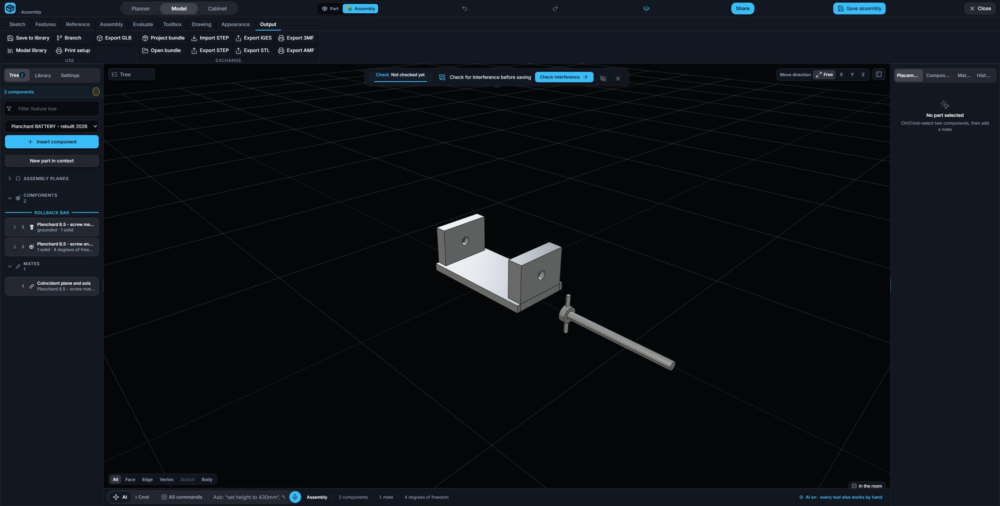

# Plane-to-axis Coincident acceptance

Implemented the book's Switch Front plane to Housing SwitchHole axis mate as a real Coincident constraint.

The exact reference chooser presents a separate **Exact axis** for each native cylindrical face. A saved axis reference retains its source face identity. Each solve resolves that face again and derives the current infinite axis; unavailable native topology is rejected rather than replaced with a captured stale axis.

For one plane and one axis, the solver enforces two independent equations: the axis origin has zero signed distance to the plane, and the axis direction has zero dot product with the plane normal. Both holder orders work. Two free components with one grounded therefore retain four degrees of freedom. Existing plane-to-plane Coincident remains unchanged; two axes and a raw cylindrical face are rejected for this mode.

## Actual Chrome acceptance

Continued the independent two-part QA assembly made from fresh task-created vice parts. Removed its test Lock mate through the tree, selected the base bore's Exact axis and the screw's Front plane, and clicked **Coincident plane and axis**.

- Visible result: two components, one mate, four degrees of freedom.
- Normal Save completed with clean Save state.
- Normal Project bundle exported 542,857 bytes.
- Reloaded Chrome and reopened the saved record through the library. The tree labels it **Coincident plane and axis**, still one mate and four degrees of freedom, without mate issues.

Protected bundle: `Plane-axis-Coincident-fresh-browser-2026-09-30.mforge`.

47 production/nested/solver regressions and 10 chooser/plane-axis regressions passed. Source gates passed: 614 linked modules and 1490 source assertions.

This independent acceptance does not claim final FLASHLIGHT clearance; its actual Switch mate is handled by the parent workflow.
