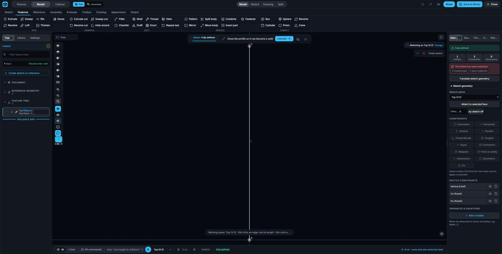
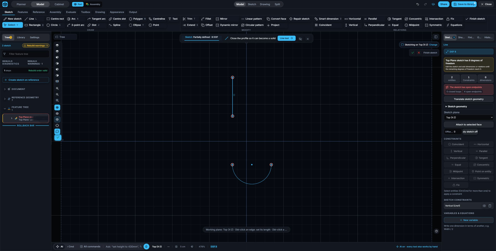

# Sketch fit and finite tangent acceptance

Fresh scratch document created from blank in desktop Chrome, tab 710849267. Model geometry was authored through the browser UI.

## Vertical fit and toolbar zoom

A Top sketch line was created, then its endpoints were fixed through Set point coordinates at (0, 3) cm and (0, 0) cm. The sketch was saved and reopened from the library.

The first browser check exposed a remaining crop: the preview kept its thumbnail ratio while the full model pane was active. The renderer now measures the model pane height, and plane fitting leaves 72 pixels for overlay controls. After reloading the saved scratch sketch, Zoom to fit showed both endpoints clear of the banner and status bar. Zoom out changed the visible scale from 16483% to 13187%; Zoom in restored 16483%.

## Finite tangent inference

A second blank disposable Top sketch was created with Arc1, a semicircle below the test line. A vertical Line1 was drawn along the circle's infinite tangent extension, ending above the arc. The exact inspector listed two entities and only one relation, Vertical (Line1). No Tangent relation was inferred to Arc1.

## Verification

Eight focused tests pass in `tests/paperclip_inference_fit.test.mjs`, including finite line and arc contact, tolerance measured in pixels, arc bounds, both camera axes, production preview sizing, and toolbar zoom. Module, import-link and source-assertion gates pass (586 modules; 1498 assertions).

Root paperclip and spring documents were not touched. QuattroSeal was begun from blank in separate tab 710849276 with a fully defined Front path of diameter 100 mm. Work switched to the curved Rib gap before authoring its cross section. The seal's unprinted vertical lobe-center spacing is estimated as 9 mm from the illustration; horizontal spacing 15 mm, R5/R10, and path diameter 100 mm are printed values.
