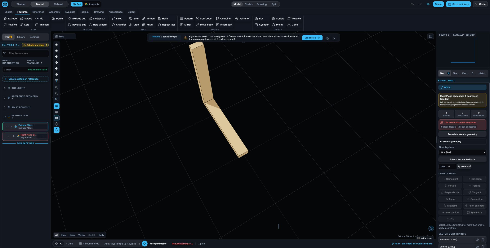
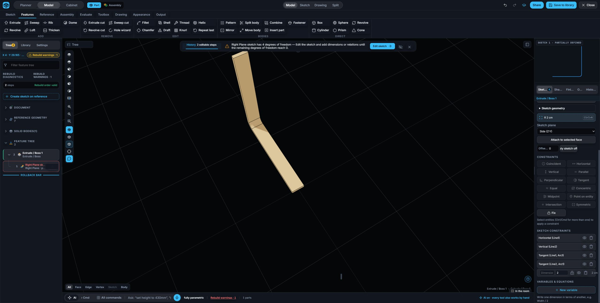

# Thin Extrude acceptance — 2026-09-30

The binder-clip workflow requires an open section to be extruded with wall thickness. Extrude and Extrude Cut now accept a connected open chain, automatically enable Thin feature when no closed profile exists, and expose Wall thickness and Thickness direction (Mid-plane, One side, Other side). Depth retains its independent symmetric/mid-plane option.

Both live preview and exact regeneration expand the original named sketch entities through `thinSketchProfile`; feature history retains the source entity IDs, thickness and direction. Upstream sketch edits and wall-thickness edits therefore regenerate the band.

## Browser acceptance

Started a blank document in desktop Chrome. Created a new Right-plane sketch and mouse-drew two connected perpendicular lines. Finished the open sketch, opened Extrude, verified Thin feature was automatically checked, entered 4 cm depth, 1 cm wall, symmetric depth and Mid-plane thickness. Committed one exact solid with two history steps. Reopened the feature and changed Wall thickness to 2 cm: native `BREP geometry regenerated` succeeded and the resulting bounds widened by the expected half-thickness on each side. Saved through the library as `Thin Extrude QA - fresh open L 2026-09-30`.

The QA sketch is intentionally an arbitrary open L with four remaining degrees of freedom, not a book model. No seed model or programmatic geometry authoring was used.

## Verification

- `tests/cad_thin_extrude.test.mjs`: 4/4 pass, including exact band volume, upstream source length edit, thickness edit, exact subtractive host volume, invalid references, and open-chain command availability.
- Thin Extrude, existing Thin Revolve and projection suites: 14/14 pass before adding the additional cut case.
- `npm run check`: no free identifiers, 593 module links, 1489 source assertions pass.

## Mixed line and arc extension

The helper now supports connected open chains containing lines and circular arcs. It offsets arcs according to their traversal direction and joins offset walls using analytic line/line, line/circle and circle/circle intersections. Trimmed arcs receive an interior point on the intended traversal, retaining native circular walls. Collapsed radii or corners that cannot be joined at the chosen thickness return an explicit diagnostic.

Additional exact tests cover a tangent line-arc-line band, associative thickness, source endpoint and arc-radius edits, reverse traversal, opposite-curvature two-arc S sections, non-tangent line/arc corner intersections, exact volume, and collapsed-band rejection. Thin Extrude and existing Thin Revolve suites: 13/13 pass. `npm run check` passed again: 593 module links and 1489 source assertions.

Fresh Chrome acceptance: created another blank Right-plane document, mouse-drew two perpendicular lines and clicked Sketch Fillet on their common vertex. The native sketch contained three connected entities with Tangent relations and R1.27 cm. Thin Extrude with 4 cm symmetric depth and 1 cm Mid-plane wall produced one exact solid. Edited the original R dimension to 2 cm, ran Force Rebuild, observed `Model force-rebuilt`, one solid and the widened bounds, then saved as `Mixed line-arc Thin Extrude QA - fresh 2026-09-30`.

